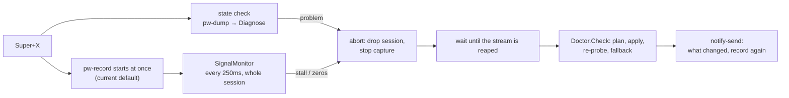

# Mic Self-Check: Detecting and Repairing a Broken PipeWire Mic

Reference for `internal/mic` and its wiring into eager capture (issue 177). Read this before
changing how voxi judges or repairs the input device. Tuning lives in `spec/eager.yaml`
`mic_check`.

## Problem

Switching between Bluetooth headphones and speakers, and carrying the laptop between rooms, often
leaves PipeWire recording from a mic that delivers nothing: a saved default that names a device
that is no longer connected, or a Bluetooth link whose audio transport failed. Eager capture runs
`pw-record` without a target, so it follows whatever the default is and silently records nothing.

## Flow

The fast path is never delayed. The check runs alongside the recording:

The first chunk of a broken session is lost by design; the notification asks the user to press
Super+X again. voxi does not restart or salvage the session.

## Components

| Piece | Role |
| :--- | :--- |
| `mic.ParseDump` | `pw-dump` JSON → `State`: default and saved default source, sources, cards, profiles, active routes |
| `mic.Diagnose` | Pure. Faults visible in the state: `no_default`, `stale_configured`, `bluetooth_no_mic` |
| `mic.SignalMonitor` | Pure. Judges the captured audio: `dead_signal` |
| `mic.Plan` / `mic.Fallback` | Pure. Problems → actions (commands plus the line the user is told) |
| `mic.Doctor` | Probe → diagnose → plan → apply → re-probe until settled → fallback. Host boundary is `Probe` and `Run` |
| `internal/eager/micwatch.go` | Runs the check per session, drops the session, repairs after the reap, notifies |
| `voxi mic [--fix]` | Same diagnosis and repair by hand |
| `voxi doctor [--fix] [--yes]` | Checks the complete audio stack, including `mic.Diagnose`; asks before each repair, saves a pre-repair `pw-dump`, and rechecks afterward |

`voxi doctor` reads its check list, systemd units, journal signatures, process names, and repair
templates from the embedded `spec/doctor.yaml`. Journal matches and core dumps are evidence and
appear as `WARN` with a `see:` hint. They do not trigger repairs or a fault exit status. Use
`--yes` to apply all available repairs without prompts; `--fix` prompts on stdin and will not
apply answers from a non-terminal input stream. Snapshots are saved under
`$XDG_STATE_HOME/voxi/doctor/` or `~/.local/state/voxi/doctor/`.

Repairs are deliberately narrow: clear only the saved default source
(`pw-metadata -d 0 default.configured.audio.source`), switch a plain Bluetooth headphone input to
headset mode (`wpctl set-profile`), and fall back to a built-in mic (`wpctl set-default`). No
service restarts and no full WirePlumber state reset, which would forget all volumes and profiles.
(This holds for the automatic mic check; `voxi doctor --fix` may restart WirePlumber after asking,
see [AudioDoctor.md](AudioDoctor.md).)
A stale saved default alone is not urgent while another mic works.

## Decisions and Pitfalls

- **Bluetooth in A2DP is normal.** WirePlumber 0.5 keeps a loopback input (`bluez5.loopback`)
  for each headset, switches the card to headset mode by itself when something records from it,
  and restores A2DP 2s after the last stream closes (`bluetooth.autoswitch-to-headset-profile`).
  Treating "headphones in A2DP" as broken would abort every headset recording, and a manual
  headset switch does not stick. Only non-loopback Bluetooth inputs get `bluetooth_no_mic`.
- **Repair after the reap.** Applying a change while the broken stream is still open lets
  WirePlumber's restore undo it when the stream closes.
- **Stall, not zeros, is the Bluetooth failure.** Measured live: with a failed transport,
  0.7s of audio arrived in 3s. A working headset emits exact zeros for 1-3s while switching, so
  all-zero audio counts as dead only for built-in mics, which always carry noise.
- **Pick a fallback with an available port.** WirePlumber ignores a saved default whose input
  route is unavailable (seen with Mic2 on the T14), so the fallback picks the non-Bluetooth source
  with an available input route and the highest route priority.
- **Session ends itself.** The drain is abandoned with drop reason `mic_repaired` and
  `eagerSessionManager.StopSession` clears the daemon state only if that session is still active.
  The agent's cached recording state is re-checked against the daemon on status.

## Bluetooth Headset Dictation (issue 210)

Soft speech from a Bluetooth headset was dropped by the acoustic gate (mean RMS 83-109 against
`MinMeanRMS` 120). Two measures address it:

- **Digital gain, automatic.** When the default source is a Bluetooth input matched by
  `bluetooth_mic.node_matches` (`spec/eager.yaml`), each captured frame is multiplied by
  `bluetooth_mic.gain_factor` (2.75) before the gate and ASR, with an int16 clamp. System volume is
  never changed, and built-in mics get no gain. The gain is resolved by an asynchronous PipeWire
  probe; frames read before it finishes pass at gain 1 (a short window at session start).
  The value is the spec's `gain_factor` unless `bluetooth_mic_gain` is set in
  `~/.config/voxi/config.yaml`: `voxi settings set bluetooth_mic_gain 1.5` (or `default` to clear,
  `1` to turn the gain off). It must be above 0 and at most the spec's `gain_max` (16). The daemon
  reads it at the start of each dictation session, so no restart is needed. `voxi settings --dump`
  and `--json` show it, and the interactive menu has a Bluetooth Mic Gain row.
  `voxi monitor -w` applies the same gain to its mic meter (issue 214): the status line shows
  `×2.75` while it is not 1, and the meter reads the level voxi hears. The monitor re-probes the
  default source on each collect tick, so a switch to another mic moves the gain too.
- **Keep-awake and autoswitch-off, opt-in.** `voxi mic headset` writes the WirePlumber drop-in
  (`bluetooth_mic.dropin_name`) that stops the idle headset source from suspending, turns off the
  switch to the headset (HFP) profile, and moves Bluetooth cards that are on `a2dp-sink` to
  `headset-head-unit`, because with autoswitch off the mic exists only in the HFP profile.
  `voxi mic headset --off` undoes what voxi did. `voxi mic headset --status` only reports.

**Gain factor derivation.** The reference is the 2026-11-02 host measurement: at source volume 1.4,
soft-speech chunk RMS was 517-1139 for the utterances measured. The factor 2.75 is 1.4³ = 2.744,
rounded to two decimals. This assumes wpctl's volume scale is cubic, which is supported only by a
WirePlumber bug report and merge request that cite the cubic mapping; it is not verified against the
WirePlumber source. Soft speech at RMS 83 and 109 becomes about 228 and 300, clearing the 120 gate.
The measured 517-1139 came from different utterances than the 83-109, so the owner verifies the
spread by dictating. Loud speech saturates at int16.

**Noise trigger caveat.** The gate's `ThresholdRMS` (150) is per frame and applies after gain. A raw
frame at RMS of about 55 or more now reaches it, so breaths and bumps that were ignored before can
start an utterance. Quiet room noise (raw RMS 13-20) stays below it. A candidate is still rejected
when it is too short or too quiet; this is the first thing to check if false starts appear.

**Commands.** `voxi mic headset` enables and prints the drop-in state, the autoswitch change, the
card pin, the cost, and the undo. `voxi mic headset --off` disables. `voxi mic headset --status`
reports the keep-awake state. Doctor's mic line shows the same status when the default mic is
Bluetooth. `--adopt` and `--off` cannot be combined with `--status`, and `--adopt` cannot be combined
with `--off`.

**Ownership.** The drop-in is voxi's only when its first line is exactly `dropin_marker`
(`# managed-by: voxi mic headset`). A drop-in with the marker elsewhere, or without it, is not voxi's:
enable refuses and names `--adopt`, and disable leaves it alone. `--adopt` replaces a foreign drop-in
with voxi's; use it only when you know the file is an old manual fix for the same problem.

**Restore record.** Enable records in the drop-in whether it turned autoswitch off (a restore line,
`voxi-restore-autoswitch: true`). `--off` restores autoswitch to on only when that record is present.
If autoswitch was already off before voxi ran, no record is written and `--off` leaves it off.
Re-running enable keeps the existing record. If autoswitch cannot be read, enable refuses and changes
nothing.

**Card profile.** `--off` does not revert a Bluetooth card that enable pinned to `headset-head-unit`.
Restoring autoswitch lets WirePlumber switch back to the profile the card needs when capture stops,
which is expected but not verified live. Check `pactl list cards` after `--off` if playback stays at
call quality.

**Refusals.** Enable and disable refuse without `wpctl`, and enable refuses while WirePlumber is not
running. Disable works while WirePlumber is stopped, unless it has to restore autoswitch.

**Costs.** Keep-awake keeps the headset mic link open while idle, which costs headset battery. Autoswitch
off and the HFP pin leave playback at call quality (HFP) while voxi's setting is on.

## Known Limits

- If 10 utterances queue behind transcription, capture reads block and could look like a stall.
  Not seen live.
- A deliberately muted built-in mic is reported as "delivers no audio" and the recording stops.
- Only tested with one Bluetooth headset ("Der Kopfhörer"); speakers are never switched to headset
  mode (`device.form-factor` must be a headphone type).
